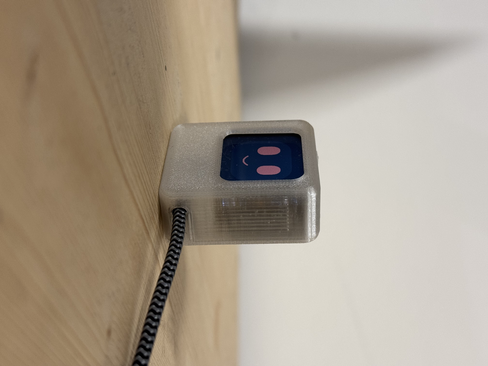

# PIP - Dalla chat alla scrivania

Un mini compagno da scrivania ESP32 con faccina animata, orologio, meteo, timer e Agenda Google facoltativa. Progettato e sviluppato con ChatGPT, costruito e provato da Alessandro Cavestro.

## Scarica il progetto completo

**Profilo di stampa aggiornato il 23 novembre 2026:** [PIP-v24-A1-PETG-MakerWorld.3mf](PIP-v24-A1-PETG-MakerWorld.3mf). Per stampare con Bambu Studio o caricare il profilo su MakerWorld usa questo file al posto del 3MF incluso nel vecchio ZIP. Geometria e disposizione dei tre pezzi sono identiche; il file usa i preset ufficiali Bambu Lab A1 e Generic PETG, con le modifiche di progetto dichiarate. Il vecchio ZIP conserva il preset SUNLU personalizzato, che MakerWorld ha rifiutato.

Il nuovo progetto mantiene 0,20 mm, tre pareti, 20% di riempimento, supporti e brim disattivati, 240/70 °C e portata 6 mm³/s. Slicing locale senza avvisi, circa 1 h 31 min e 15 g; non è stata eseguita una nuova stampa fisica. Bambu Handy usa i parametri di macchina e materiale dei preset selezionati nell’app. Il profilo è stato reinviato alla verifica MakerWorld il 23 novembre; approvazione ancora in attesa.

**[PIP-kit-download-1.0.0-rc2.zip](PIP-kit-download-1.0.0-rc2.zip)** contiene tutti i file del progetto. Apri la pagina del file e usa il pulsante di download; estrai poi l'archivio sul tuo computer. Non occorre un abbonamento ChatGPT per usare PIP.

Nella cartella estratta `PIP` trovi:

| Cartella | Contenuto |
|---|---|
| `hardware/3MF` | Progetto Bambu Studio v24 completo: corpo, retro e tastino |
| `hardware/STL` e `hardware/STEP` | Le tre parti da stampare e i CAD da modificare |
| `firmware/PIP_Public` | Software completo da aprire con Arduino IDE |
| `integrations/google-calendar` | Codice facoltativo per il proprio account Google |
| `docs` | Componenti, installazione, montaggio, uso e case study |
| `assets` e `licenses` | Foto reali, tavola CAD e licenze dei componenti di terzi |

Il firmware e il kit scaricabile restano invariati; il riepilogo delle prove sul dispositivo è aggiornato separatamente in [TESTING.md](TESTING.md). La documentazione dentro l’archivio è datata 18 novembre 2026.

Leggi prima il `README.md` dentro il kit. Il file `SHA256SUMS.txt` incluso permette di controllare l'integrità dei file estratti. I sorgenti sono nell'archivio, organizzati per cartelle; non sono visualizzati come file separati nella radice di questo repository.

**[Guida illustrata in PDF](PIP-guida-illustrata.pdf)** - otto pagine con componenti, software, stampa, montaggio e comandi.

## La storia

La domanda iniziale era semplice: può una conversazione diventare un oggetto vero? ChatGPT ha preparato proposte, modelli stampabili, firmware e istruzioni. Alessandro ha scelto la direzione, comprato i componenti, stampato, montato e riportato i problemi reali.

Il percorso è passato da campioni di tolleranza e revisioni del tastino a una correzione del software: il personaggio continuava a reagire anche da fermo. I dati del sensore hanno permesso di riprodurre il difetto e correggerlo. Il case study completo è nel kit, `docs/06-case-study.md`.

## Componenti di riferimento

Waveshare **ESP32-S3-LCD-1.69 V2 senza touch**, cavo dati USB-C/USB-C **deleyCON MK6334** con una spina a 90°, quattro viti M2 x 8, tre M2,5 x 8 svasate con tre dadi, alimentatore USB e circa 15 g di SUNLU PETG Trasparente Bianco. Il profilo è per Bambu Lab A1, ugello 0,4 mm, PEI testurizzato, 0,20 mm, tre pareti, 20%, 240/70 °C, supporti e brim OFF. Prima di acquistare o stampare leggi la distinta nel kit: forma della scheda e del connettore contano.

## Stato: candidata 1.0.0-rc2

Base Studio 1.5 con la sola correzione del movimento da fermo e impostazioni per i propri dati. Funzioni di base, fine timer con ritorno alla faccina e Agenda Google verificate sul dispositivo. Restano uso prolungato e prova con interruzione prolungata della rete. [Stato aggiornato delle prove e limiti noti](TESTING.md).

Il contenitore v24 è stato realmente stampato e montato. Le foto non attestano la versione firmware. Interfaccia e guide sono in italiano. La versione resta candidata al rilascio. La scheda MakerWorld è stata reinviata alla verifica: file di stampa e guida PDF su MakerWorld dopo l’approvazione, software completo scaricabile da questo repository. Il collegamento diretto al modello sarà aggiunto quando disponibile.

## Licenze

- Case, foto e documentazione originali: **[CC BY-NC-SA 4.0](LICENSE-HARDWARE.md)**, con attribuzione e condivisione delle modifiche sotto la stessa licenza.
- Codice originale: **[PolyForm Noncommercial 1.0.0](LICENSE-SOFTWARE.md)**.
- Librerie e font mantengono le proprie condizioni: [dipendenze e attribuzioni](THIRD_PARTY.md); testi completi nella cartella `licenses` del kit.

Download e modifiche per uso non commerciale; nessuna autorizzazione alla vendita di stampe o file. Il sorgente ha un vincolo d'uso e non è descritto come open source. Progetto personale indipendente: ChatGPT è uno strumento di sviluppo, senza affiliazione o sponsorizzazione dichiarata.
